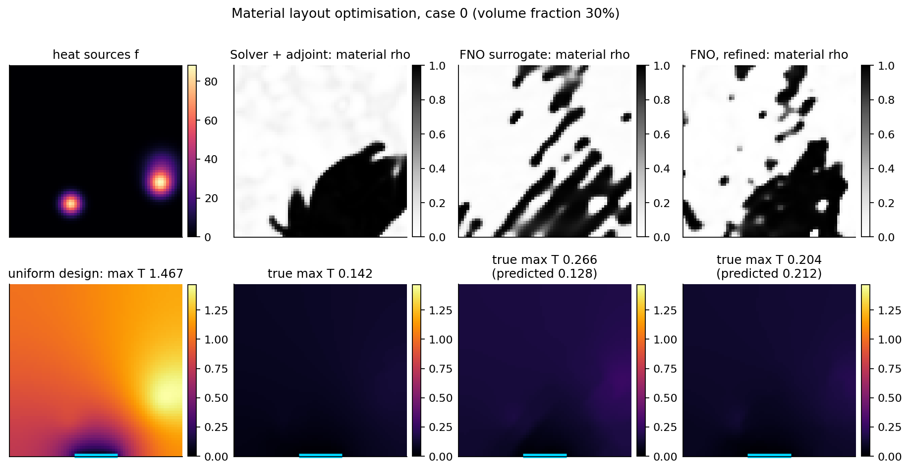
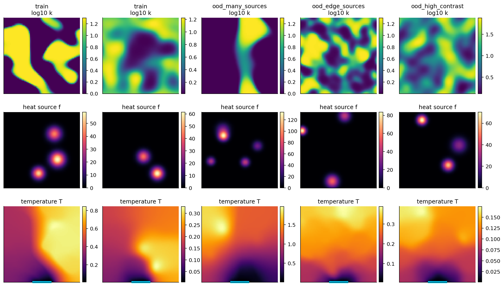
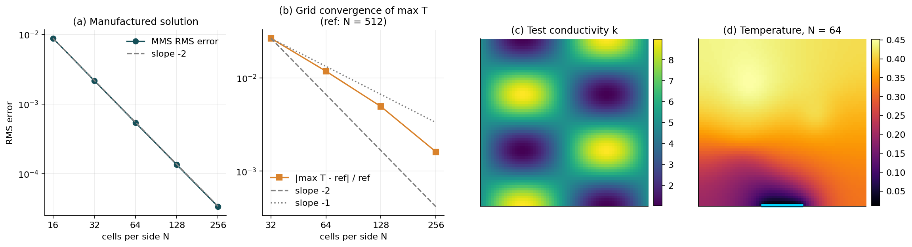
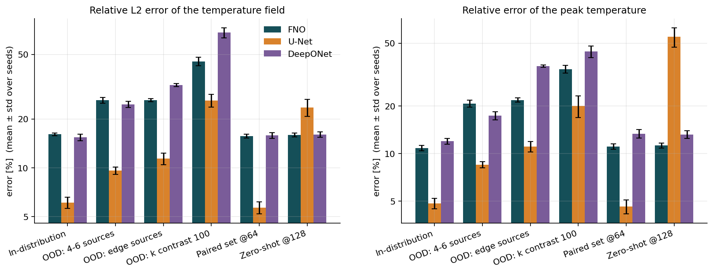
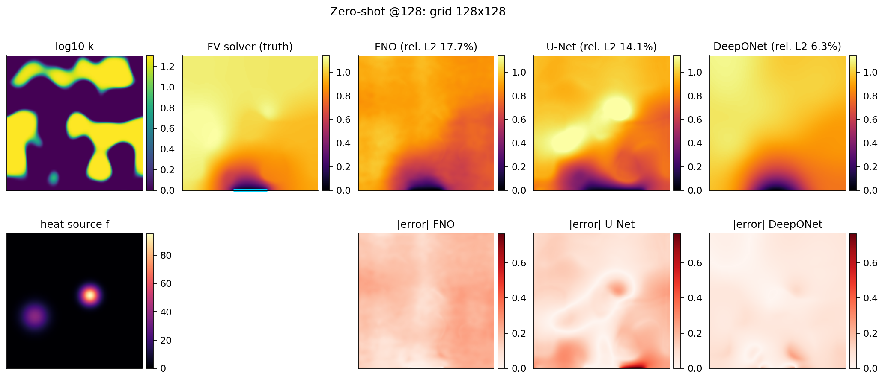
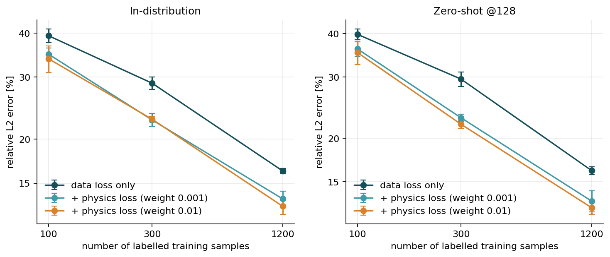
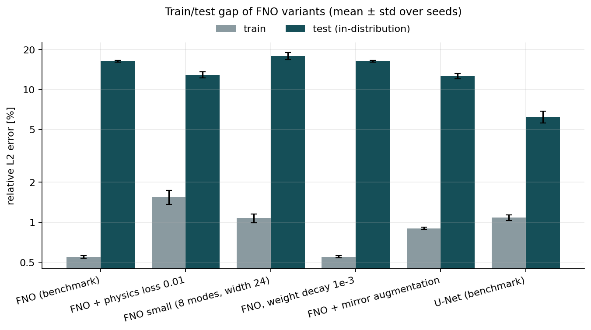
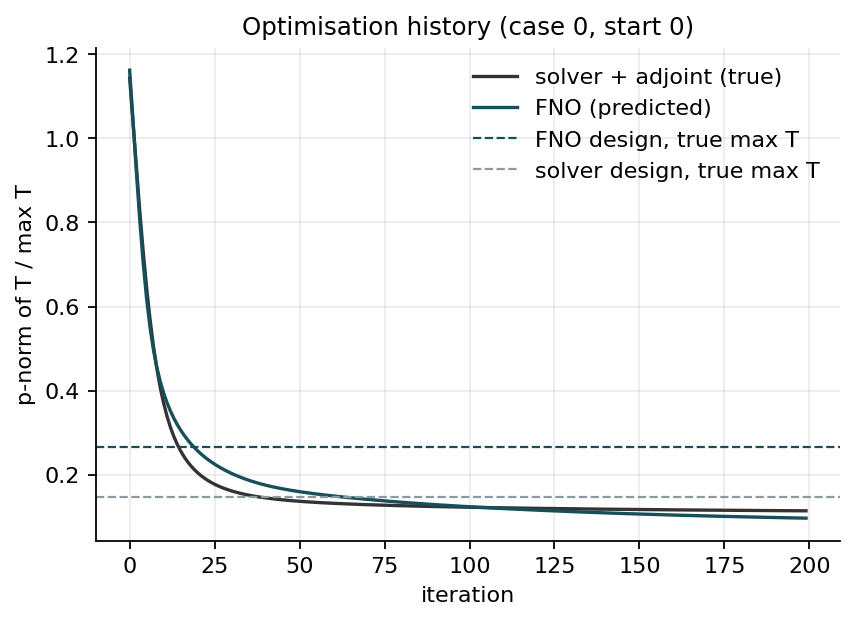

# Neural-Operator Surrogates for Thermal Design: What Works and What Doesn't

**Fourier Neural Operator (FNO) vs U-Net vs DeepONet as surrogates for 2D steady heat conduction, plus an honest test of surrogate-based layout optimisation. Every design the surrogate proposes is re-checked with a verified finite-volume solver.**

[Showcase page](https://dgh19981102-max.github.io/fno-thermal-design/) · [Full results tables](results/summary/RESULTS.md) · [中文说明](README_zh.md) · MIT licence



## Key findings (5 seeds for the benchmark, 3 for the ablations, Tesla T4)

| # | Finding | Evidence |
|---|---|---|
| 1 | **At the training resolution, the U-Net is the most accurate model**: 6.1 % relative L2 error, against 16.1 % for the FNO and 15.4 % for DeepONet. | Benchmark table below |
| 2 | **The FNO is resolution-invariant; the U-Net is not.** Applied zero-shot to 128×128 inputs, the FNO's error stays at 15.9 % (15.7 % on the same problems at 64×64). The U-Net's rises from 5.7 % to 23.5 %, and its peak-temperature error rises from 4.6 % to 55 %. | Paired super-resolution set |
| 3 | **A physics-residual loss helps the FNO at every data size**: 39.3 → 33.8 % (100 samples), 28.8 → 22.8 % (300) and 16.3 → 12.9 % (1200). Welch's t-test gives p ≈ 0.007 at 300 and 1200 samples (n = 3 seeds, so this is indicative only). | Experiment 04 |
| 4 | **The FNO's large train/test gap (0.55 % vs 16 %) is not fixed by making the model smaller.** It *is* reduced by giving the model more information, through exact mirror-symmetry augmentation (→ 12.6 %) or the physics loss (→ 12.9 %). The FNO appears to be data-limited here, not simply over-parameterised. | Experiment 08 |
| 5 | **Optimising the layout directly on the surrogate is exploited by the optimiser.** At its designs the FNO under-predicts the peak temperature by 27–52 %. The true peak temperatures are 1.9–2.6× those found by solver-based adjoint optimisation. | Experiment 06 |
| 6 | **One round of refinement makes the surrogate honest, but not competitive.** Solving 88 visited designs and fine-tuning brings the prediction error within ±8 %. The designs are still 1.4–2.0× worse than the adjoint result, and the whole loop is slower. | Experiment 06 |

In short, the neural operator is useful here as a fast, resolution-independent **screening** model. For final design decisions, the adjoint solver remains the right tool at this problem size.

## The problem

$$-\nabla\cdot\big(k(x,y)\,\nabla T\big)=f(x,y)\quad\text{on } [0,1]^2$$

- **Heat sink:** T = 0 on the middle 25 % of the bottom edge. The rest of the boundary is adiabatic (a "volume-to-point" cooling problem, as in an electronics heat spreader).
- **Inputs:** a random conductivity field `k` in [1, 20], either a smooth log-type field or a two-phase material layout, and 1–3 Gaussian heat sources `f`.
- **Output:** the temperature field on a 64×64 grid. There are 1200 training, 200 validation and 300 test samples, plus 3 out-of-distribution sets and a paired 64/128 set.



## 1. Reference solver (verified before any learning)

The reference solver uses cell-centred finite volumes with harmonic-mean face conductivities and a sparse LU solve (SciPy/SuperLU).

- **Method of manufactured solutions** (variable k, mixed boundary conditions): observed convergence order 2.02 / 2.00 / 2.00 / 2.00.
- **Layered 1D analytic solution:** matches.
- **Discrete energy balance:** heat generated equals heat through the sink to better than 3e-13 (relative).
- **Real partial-sink problem:** the peak temperature converges at roughly first order, because the boundary condition switches type at the sink edges, which is a singularity. At 64×64 its discretisation error is about 1.2 %, so surrogate errors below that level are not physically meaningful.



## 2. Surrogate benchmark

Mean over test samples, then mean ± std over **5 seeds**. Full tables are in [results/summary/RESULTS.md](results/summary/RESULTS.md).

| Model | Params | In-dist. | OOD 4–6 sources | OOD edge sources | OOD k-contrast 100 | Paired @64 | Zero-shot @128 |
|---|---|---|---|---|---|---|---|
| FNO | 2.37 M | 16.1 ± 0.3 % | 26.1 ± 1.1 % | 26.1 ± 0.6 % | 45.3 ± 2.7 % | 15.7 ± 0.4 % | **15.9 ± 0.5 %** |
| U-Net | 1.95 M | **6.1 ± 0.5 %** | **9.6 ± 0.5 %** | **11.4 ± 0.9 %** | **26.0 ± 2.4 %** | **5.7 ± 0.5 %** | 23.5 ± 2.8 % |
| DeepONet | 0.96 M | 15.4 ± 0.8 % | 24.6 ± 1.1 % | 32.3 ± 0.6 % | 68.1 ± 4.9 % | 15.8 ± 0.6 % | 16.0 ± 0.6 % |

The peak-temperature relative error follows the same pattern: U-Net 4.8 %, FNO 10.8 %, DeepONet 12.0 % in distribution. At 128×128 it is 55 % for the U-Net and 11 % for the FNO.




## 3. Physics-informed loss and FNO diagnostics

The physics term is the residual of the **same discrete operator** that generated the labels, ‖A(k)T̂ − b‖² / ‖b‖². A weight of 0.1 made training collapse towards T ≈ 0 in pilot runs, because the discrete residual strongly amplifies high-frequency noise. The ablation therefore uses weights of 0.001 and 0.01.



Experiment 08 was added after the first full run to test the explanation "the FNO over-fits". Each variant changes one thing, was declared before running, and is reported below as measured:

| FNO variant (3 seeds) | Train | Test | Reading |
|---|---|---|---|
| Benchmark | 0.55 % | 16.3 % | — |
| Smaller (8 modes, width 24, 0.6 M params) | 1.07 % | 17.9 % | Less capacity makes it *worse*, so this is not plain over-parameterisation. |
| Weight decay 1e-3 | 0.55 % | 16.3 % | No effect. Caveat: with decoupled AdamW decay at lr = 1e-3 this is a weak regulariser, so the test is inconclusive. |
| Mirror augmentation (exact symmetry) | 0.90 % | **12.6 %** | More effective data helps. |
| Physics loss 0.01 | 1.55 % | 12.9 % | Extra physical information helps. |



## 4. Design optimisation: surrogate vs adjoint solver

**Task:** place 30 % high-k material (SIMP density, filtered, exact volume constraint) to minimise the peak temperature. There are 3 heat-source layouts and 8 starting designs each, with 200 Adam iterations. All numbers are true peak temperatures from the solver.

| Case | Uniform | Solver + adjoint | FNO surrogate (its prediction) | Refined FNO (its prediction) | Time solver / FNO / refined |
|---|---|---|---|---|---|
| 0 | 1.467 | **0.142** | 0.266 (0.128, −52 %) | 0.204 (0.211, +4 %) | 31 s / 5 s / 59 s |
| 1 | 2.233 | **0.355** | 0.678 (0.495, −27 %) | 0.656 (0.651, −1 %) | 32 s / 4 s / 58 s |
| 2 | 2.482 | **0.444** | 1.155 (0.576, −50 %) | 0.885 (0.951, +7.5 %) | 33 s / 4 s / 58 s |

- All methods cut the peak temperature strongly compared with the uniform layout: 82–90 % for the adjoint method and 53–82 % for the surrogate.
- The surrogate optimiser is about 8× faster per problem. Counting only time, its offline cost (26 s of data generation plus 387 s of training) is recovered after about 15 problems. **This break-even figure ignores that its designs are clearly worse**, so it should not be read as "the surrogate pays off after 15 designs".
- The refinement loop is dominated by fine-tuning time (49 s).



## 5. Speed

| Method (64×64) | ms / sample | Speed-up vs solver |
|---|---|---|
| FV solver, SciPy SuperLU, Colab CPU | 14.8 | 1× |
| FNO, T4 GPU, batch 1 / 64 | 2.58 / 0.37 | 5.7× / 41× |
| U-Net, T4 GPU, batch 1 / 64 | 2.62 / 0.52 | 5.7× / 29× |
| DeepONet, T4 GPU, batch 1 / 64 | 1.63 / 0.04 | 9× / 366× |
| FNO on the same CPU, batch 1 | 15.3 | 1.0× (no gain) |

Speed-ups exist only on a GPU and grow with batch size and grid size (FNO at 128×128 on the GPU: 57×). On a CPU the surrogates are no faster than the sparse direct solver at this size.

## Limitations

- **Ground truth:** labels are the 64×64 discrete solution, which carries about 1 % discretisation error in the peak temperature.
- **Data:** a single dataset (one random draw); seeds vary only the initialisation and batch order. With 3–5 seeds, p-values are indicative.
- **Tuning:** hyper-parameters were not tuned per model. Every model used the same budget of 15 000 steps. A tuned FNO, for example with more modes, augmentation and the physics loss combined, might close part of the gap to the U-Net. That combination was not run.
- **Problem size:** the problem is linear and small, so the direct solver and adjoint gradients are cheap. The case for surrogates is stronger for nonlinear, transient or 3D problems, but this project does not test those.
- **Hardware:** all timings are specific to the hardware stated (a Colab T4 GPU and a Colab CPU with 1 PyTorch thread).

## Reproduce

```bash
pip install -r requirements.txt
python -m pytest -q                      # 23 tests: solver accuracy, spectral layer, adjoint gradient, training loop
cd experiments
python 01_verify_solver.py && python 02_generate_data.py
python 03_train_benchmark.py            # GPU recommended
python 04_physics_ablation.py
python 05_speed_benchmark.py
python 06_design_optimization.py
python 08_fno_diagnostics.py
python 07_make_figures.py               # tables -> results/summary, figures -> docs/figures
python 09_make_cover.py                 # portfolio cover image -> docs/upwork_cover.png
```

- `--quick` runs any script in minutes on a CPU; its numbers are **not** results.
- On Colab, use `notebooks/colab_run_all.ipynb`. The project lives on Google Drive, and interrupted runs resume from checkpoints.

```
src/thermal_no/   solver.py  physics.py  data.py  models/{fno,unet,deeponet}.py  train.py  optimize.py  metrics.py
experiments/      01-09 scripts + configs/default.yaml (all settings) + configs/quick.yaml
tests/            unit tests
results/          raw per-run JSON (every seed) + summary/RESULTS.md
docs/             GitHub Pages showcase (index.html) + figures
```

## References

- Li et al., *Fourier Neural Operator for Parametric PDEs*, ICLR 2021.
- Li et al., *Physics-Informed Neural Operator*, 2021.
- Lu et al., *DeepONet*, Nature Machine Intelligence 2021.
- Ronneberger et al., *U-Net*, MICCAI 2015.
- Bendsøe & Sigmund, *Topology Optimization*, Springer 2003.
